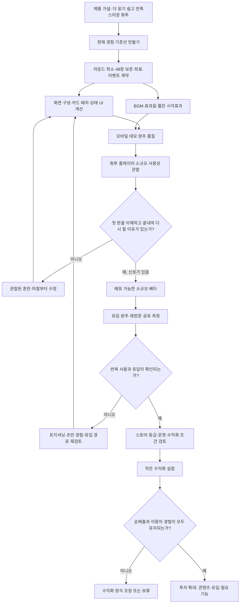
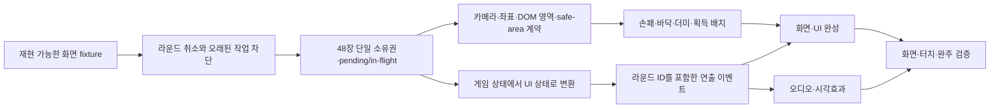

# 화투 게임 제품 전략 및 실행 로드맵

작성일: 2026-10-03  
기준 저장소 상태: `main`, 로컬 커밋 `49caa89`  
목적: AI로 기존 보드게임을 더 나은 모바일 경험으로 만들면 실제 수요와 수익으로 이어질 수 있다는 가설을, 이 화투 프로젝트에서 검증 가능한 단계로 바꾼다.

## 1. 전략 요약

목표는 3D 기능 자체를 판매하는 것이 아니라, 화투를 아는 사람이 쉽게 시작하고 한 판을 끝낸 뒤 다시 찾을 만큼 편하고 만족스러운 플레이 경험을 만드는 것이다. 시각 품질은 첫인상과 차별화에 쓰고, 반복 사용과 유입은 별도 실험으로 확인한다.

게시물의 월 1,000달러는 참고할 만한 개인 사례지만 이 프로젝트의 매출 예측으로 간주하지 않는다. 플랫폼, 유입량, 재방문, 광고·결제 방식, 수수료와 비용이 알려지지 않았으므로 우리 제품에서 같은 결과가 재현된다는 근거가 아니다.

초기 실행 범위는 현재 있는 1인 대 CPU 맞고를 완성도 높은 모바일 게임으로 다듬는 것이다. 온라인 멀티플레이, 여러 게임 모드, 유료 재화는 핵심 플레이의 품질과 반복 수요를 확인한 뒤 결정한다. 이는 현재 코드의 구조를 버리자는 뜻이 아니라, 사용자 수요가 확인되기 전에 범위를 넓히지 않는 순서 제안이다.

## 2. 제품 가설과 판단 기준

### 핵심 가설

> 화투를 아는 플레이어는 패가 잘 보이고, 조작에 바로 반응하며, 점수와 특수 상황을 쉽게 이해할 수 있는 모바일 화투 게임을 반복해서 사용할 것이다.

### 하위 가설

| 가설 | 확인할 증거 | 아직 증명되지 않은 것 |
| --- | --- | --- |
| 화면과 카드 연출이 경쟁 제품보다 만족스럽다 | 실제 기기에서 패 가독성, 배치, 반응성에 대한 비교 관찰 | 3D 모델의 존재만으로 선호·설치가 늘어나는지 |
| 룰과 진행 표시가 한 판 완주를 돕는다 | 첫 판 완료율, 막힌 선택, 룰 문의 횟수 | 자동화 테스트 통과만으로 실제 이해가 보장되는지 |
| 게임이 다시 열릴 이유를 제공한다 | 재방문, 다시 시작, 공유 의향 | 한 번의 긍정적 반응이 장기 잔존을 의미하는지 |
| 자연 유입이나 공유가 가능하다 | 초대·공유 행동, 유입 출처별 시작·완주 | 게시물 사례의 유입 경로가 우리 제품에도 적용되는지 |
| 수익이 운영비와 제작비를 넘을 수 있다 | 검증된 이용량과 수익화 실험의 순매출 | 매출 사례가 순이익인지, 반복 가능한지 |

### 제품 원칙

- **화면 우선:** 카드 가독성, 명확한 턴 안내, 반응형 배치, 결과 이해를 우선한다.
- **사건 중심 피드백:** 패 제출·획득·쪽·설사·따닥·GO/STOP·승패가 화면과 소리에서 일관되게 느껴지도록 한다.
- **동일한 규칙, 양측 표현:** CPU도 플레이어와 같은 규칙으로 진행하고, CPU의 행동 이유와 결과도 플레이어가 이해할 수 있게 표시한다.
- **짧은 연출:** 카드 게임의 리듬을 늦추지 않는 짧은 애니메이션과 효과를 사용하며, 무음과 reduced-motion에서도 의미가 유지되어야 한다.
- **측정 가능한 변경:** 큰 기능을 추가하기 전에 어떤 사용 신호가 바뀌어야 성공인지 정한다.
- **작은 기술 선행:** 카메라 전체 교체, 엔진 변경, UI 프레임워크 도입을 목표로 삼지 않는다. 화면 개선을 막는 취소·좌표·이벤트 계약만 먼저 고정한다.

## 3. 전체 전략 흐름

`H`, `L`, `P`의 통과 기준은 현재 미정이다. 임의의 수치 목표를 정하지 않고, 먼저 기준선과 소규모 관찰 데이터를 모은 뒤 제품 목표에 맞게 정한다.

## 4. 화면 구성·UI·BGM·효과음·시각효과 구현 작업 순서

이 절은 최종 화면 구현 순서다. 각 단계에 선행 조건과 검증 방법을 둔다. 화면 표현을 먼저 고정하고 뒤늦게 상태·좌표·취소 구조를 바꾸는 비용을 줄인다.

| 순서 | 작업·산출물 | 선행 조건 | 검증 방법 |
| --- | --- | --- | --- |
| 1. 핵심 화면 기준선 | 배분 완료, 일반 턴, 후보 선택, GO/STOP, 결과 화면의 재현 가능한 fixture | 배분 seed와 장면 내 카드 방향 난수 분리, 48장 고유 카드 fixture | 같은 입력의 화면 2회 캡처 비교. 모바일 세로와 데스크톱 기준 화면 기록 |
| 2. 라운드 취소·자원 수명 | 재시작·종료 시 타이머와 트윈을 취소하고 오래된 작업의 상태 변경을 막음 | 라운드 세대 식별, Promise 종료 규칙, 카드 자원 소유 규칙 | 배분·카드 이동·더미 공개·CPU 대기 중 재시작. 오래된 이벤트와 상태 변경이 없는지 확인 |
| 3. 카드 소유권 invariant | 손패·바닥·덱·획득·pending·in-flight 카드의 단일 소유 모델 | 상태 전이 시 소유권을 한 번만 이동하는 규칙 | 플레이어·CPU와 선택 대기, 쪽·설사·따닥에서 총 48장, 고유 ID 48개, 월별 4장 |
| 4. 좌표·안전 영역 계약 | XY 카드 면, Z 겹침 순서, 카메라 정책, DOM과 월드 간 영역, 상·하단 UI 점유 정의 | 현재 XY 카드 평면을 유지하고 실제 UI 크기 측정 | 세로·가로, 회전, safe-area 경계에서 카드 영역과 터치 좌표 비교 |
| 5. 손패·바닥·더미 배치 | 영역별 카드 크기·간격·노출 폭과 resize 재배치 | 4번 계약 | 양측 손패 10장, 바닥 8/12/16장, 더미를 함께 둔 좁은 화면에서 겹침·오선택 확인 |
| 6. 획득 트레이와 점수 상태 | 광·열끗·띠·피 트레이, 실물 장수와 점수용 피 값, 점수·목표 힌트 | 소유권 모델과 배치 계약, 게임 상태에서 UI 상태로의 변환 | 양측 획득, 쌍피, 목표 3/5/7, 점수 변경 전후를 표시와 규칙 결과로 대조 |
| 7. 사건 이벤트 계약 | 라운드 ID, 행위자, 카드 ID, 특수 상황, 점수 전후, 결과 이유를 담은 이벤트 | 라운드 취소, 카드 소유권, 화면 상태 동기화 | 플레이어·CPU 사건이 각 1회 발행되고 UI 갱신이 효과음을 중복시키지 않는지 확인 |
| 8. BGM 상태 복구 | 사용자 동작 시작, 저장 mute/volume, 숨김·복귀, 파일 실패 fallback | 라운드 수명과 오디오 시작 정책 | 저장 mute → 새로고침 → 첫 해제, 음량 0/100, 재생 거절, 백그라운드 복귀 |
| 9. 실제 음원 연결 | 출처·사용권을 기록한 BGM 1개와 기본 SFX 3개, 파일별 실패 fallback | 사건 이벤트와 오디오 경로·동시 재생 정책 | 시작 동작·반복 경계·모바일 실제 청취, 실패한 파일과 나머지 음향의 독립성 확인 |
| 10. 사건별 피드백 | 제출·획득·점수·쪽·설사·따닥·GO/STOP·결과의 짧은 효과음과 시각 강조 | 이벤트 계약, 취소·효과 우선순위, 입력 잠금 정책 | 플레이어·CPU, 무음, 낮은 가로 화면에서 원인과 결과 전달. 1탭 조작 유지 |
| 11. 결과·접근성·완주 | 결과 breakdown, 포커스 이동·복귀, 상태 문구, 효과 축소 | UI 상태와 사건 표현 안정화 | 키보드, 긴 한글, 확대, reduced-motion, 한 판 완주와 재시작 |
| 12. 베타 빌드 | 실제 기기에서 점검 가능한 공유 버전과 실험 기록 양식 | 핵심 화면·오디오·완주 회귀 통과 | 기기별 화면·터치·음향, 콘솔 오류, 성능·자원 추이 기록 |

### 화면 작업의 최소 선행 구조

현재 `49caa89`는 2번의 기반 일부를 구현한다. 라운드 재시작·dispose에서 대기 타이머와 카드 트윈을 취소하고, 지연 이후에도 현재 라운드인지 확인한다. 애니메이션 취소 회귀 테스트를 추가했다. 전체 핵심 화면 fixture, 기기별 터치 검증, 실제 음원은 아직 별도 작업이다.

## 5. 수요 검증과 측정

### 실험 단계

1. **관찰 데모:** 화투를 아는 플레이어 5~10명에게 같은 빌드를 제공한다. 안내를 최소화하고 시작, 첫 매칭, 점수 이해, GO/STOP, 한 판 완료에서 막힌 지점을 기록한다.
2. **수정 후 재관찰:** 의견을 선호도 투표로만 처리하지 않는다. 여러 사람이 같은 지점에서 멈추거나 오해한 경우 UI·규칙 안내를 수정하고 다시 관찰한다.
3. **제한 베타:** 배포 가능한 버전에서 유입 출처와 제품 이벤트를 최소 수집한다. 수집 목적·동의·보관 기간은 배포 방식에 맞게 정한다.
4. **반복 사용 확인:** 첫 판 시작·완료, 다음 판 시작, 다음 날/7일 내 재방문, 공유 행동을 코호트별로 살핀다.
5. **수익 실험:** 반복 사용과 유입 경로가 어느 정도 확인된 뒤 광고나 장식형 유료 요소 중 하나를 작게 시험한다. 불편 증가와 이탈도 같이 본다.

### 최소 이벤트와 지표

| 단계 | 기록할 행동 | 질문 |
| --- | --- | --- |
| 발견 | 유입 출처, 설치/진입 | 어떤 게시물·검색어·초대가 실제 플레이어를 데려오는가? |
| 시작 | 새 게임 시작, 기기 화면 크기 범주 | 진입 후 첫 판을 시작하는가? |
| 이해 | 첫 제출, 첫 획득, 점수 패널 열기, 도움말 이용 | 핵심 조작과 점수를 이해하는가? |
| 완료 | 판 종료, 재시작, 이탈 시점 | 게임을 끝내며, 끝난 뒤 무엇을 하는가? |
| 재방문 | 다음 날·7일 내 실행, 완료 판 수 | 다시 방문할 이유가 있었는가? |
| 성장 | 공유 열기/완료, 초대 유입 | 기존 플레이어가 다른 플레이어를 데려오는가? |
| 수익 | 광고 노출·완료, 결제 전환, 순매출, 환불·이탈 | 수익이 이용 경험과 함께 유지되는가? |

초기 정성 테스트는 소수 참여자의 혼란을 찾는 수단이지 시장 규모나 수익성을 추정하는 표본이 아니다. 수익은 총매출이 아니라 플랫폼 비용·광고 비용·운영 비용·환불을 반영한 순액으로 평가한다.

## 6. 3D·에셋 전략

현재 구현은 SVG에서 화투 그림을 잘라 카드 텍스처로 만들고, 이를 Three.js 카드 상자 앞·뒷면에 적용한다. 따라서 제품 차별화가 이미 고유한 3D 모델에 있다고 말할 수 없다. 바닥 재질, 조명, 카드 그림자, 두께, 뒤집기·이동의 감각을 다듬는 것이 먼저다.

AI 생성 3D 에셋은 다음 조건에서만 실험한다.

- 현재 SVG/Canvas 기반 방식으로 표현하기 어려운 식별 가능한 사용자 가치가 있다.
- 생성·후처리·파일 크기·기기별 렌더링 비용을 기존 방식과 비교할 수 있다.
- 낮은 사양 기기에서 프레임 저하, 초기 로딩, 배터리 영향을 측정한다.
- 카드 그림의 권리와 새 에셋의 사용권을 확인할 수 있다.

비교 기준은 “3D가 더 멋져 보이는가” 하나가 아니다. 제작 시간, 첫 로딩, 실제 기기 성능, 카드 읽기 쉬움, 선호도, 재방문 신호를 함께 본다.

## 7. 수익화와 출시 범위

처음부터 보상형 경제나 결제를 넣지 않는다. 이용자가 돌아오는 이유와 유입 경로가 관찰되기 전에는 수익 모델을 확정하지 않는다.

검토 순서는 다음과 같다.

1. 무료 핵심 게임과 저장·복귀 안정성
2. 실제 플레이어의 재방문 및 공유 신호
3. 광고를 넣었을 때 플레이 흐름을 해치지 않는 위치 검토
4. 장식형 테마·테이블·카드 뒷면 등 비확률형 유료 요소의 선호 실험
5. 목표 플랫폼의 등급·결제·광고·개인정보 정책과 운영 부담 확인

현금 가치, 현금 환전, 사행성 유료 구조를 제품 전제로 삼지 않는다. 화투의 연령 등급과 유통 조건은 목표 지역·플랫폼·실제 기능이 정해진 뒤 공식 기준에 맞춰 별도로 확인한다.

## 8. 진행 보드와 확인 경계

### 자동으로 진행할 일

- 화면·사운드 우선순위를 지키면서 독립적으로 검증 가능한 UI/상태 결함을 수정한다.
- 라운드 취소, 카드 48장 보존, 플레이어·CPU 흐름 회귀를 유지한다.
- 핵심 화면 fixture, 브라우저 캡처, 반응형 배치 검증을 준비한다.
- 화면 이벤트 계약을 먼저 정리하고 그 위에 실제 음원과 짧은 효과를 연결한다.
- 빌드 용량, 로딩, 저사양 성능을 측정해 3D 자산 투자 근거를 만든다.

### 사용자·외부 확인이 필요한 일

- 실제 BGM/SFX 선택과 라이선스 구매·사용 승인
- 최초 출시 플랫폼과 계정·패키징·심사 준비
- 초기 타깃 플레이어와 공개 배포 범위
- 광고·장식형 판매 등 수익 방식의 실제 도입
- 실기기 최종 판정과 외부 플레이테스트 참여자 모집
- 기본 맞고 외 특수 룰, 온라인 멀티플레이의 출시 범위

확인이 필요한 선택이 생기면 그 전에 가능한 코드·화면 시안·비용 및 옵션 비교를 준비해 결정 대상을 구체화한다.

## 9. 완료 정의

**경험:** 처음 온 플레이어가 별도 설명 없이 시작하고 한 판을 끝낼 수 있으며, CPU의 행동과 결과를 이해한다.  
**화면:** 대표 비율과 회전에서 손패·바닥·획득 영역이 겹치지 않고 터치 오선택이 없다.  
**소리·연출:** 사용자 설정과 실제 재생이 일치하며, 사건의 중복·누락이 없고 무음에서도 의미가 전달된다.  
**상태:** 플레이어와 CPU, pending 선택, 재시작을 포함해 48장 고유 카드 invariant를 유지한다.  
**사업성:** 유입·완주·재방문·공유·순매출을 구분해 측정하고, 개인 사례를 목표 매출로 대입하지 않는다.  
**출시:** 목표 플랫폼과 지역이 정해진 뒤 해당 스토어 요건과 실기기 동작을 확인한다.

## 참고 문서

- [전체 검토 및 화면·오디오·효과 우선 구현 계획](20260916-comprehensive-review-and-presentation-plan.md)
- [실행 체크리스트](20260917-execution-checklist.md)
- [멀티플레이어 단계별 실행 계획](20260917-multiplayer-rollout-plan.md)
- [오디오 에셋 라이선스 메모](../../public/audio/README.md)

## 10. 2026-10-17 현재 상태 진단 및 진행 방향

이 절은 기존 전략을 대체하지 않고, 2026-10-17에 소스와 실행 가능한 검증 결과를 기준으로 확인한 상태를 기록한다. 과거 문서의 실행 기록은 당시 기록으로만 취급하며 현재 HEAD에서 재현한 결과와 구분한다.

### 목표: 확인된 내용과 아직 추정인 내용

**요청 및 저장소 지침에서 확인된 내용**
- 프로젝트는 Vite, TypeScript, Three.js 기반의 화투/고스톱 게임 프로토타입이다.
- `src/game/`에 규칙과 턴 흐름, `src/main.ts`에 화면 UI가 있다.
- 작업 우선순위는 화면 구성, UI, BGM, 효과음, 시각효과다. 플레이어와 CPU 흐름 및 48장 고유 카드 invariant를 유지해야 한다.
- 완료 기준은 첫 플레이어가 별도 설명 없이 시작하고, 패와 점수/승패를 이해하며, CPU와 한 판을 마칠 수 있고, 화면이 의도한 배치로 보이는 것이다. 이는 기존 전략 문서의 제안 기준이지 사용자 검증 결과가 아니다.

**아직 확인되지 않은 가정**
- 핵심 고객의 구체적인 연령/경험, 출시 플랫폼과 유통 경로, 오프라인/온라인 우선순위, 실제 과금 방식, 수익 목표는 확정되지 않았다.
- X 게시물의 보드게임 앱 수익 사례는 외부 주장이다. 우리 제품의 수요나 매출 가능성을 입증하지 않는다.

### 현재 상태와 근거

| 영역 | 확인된 상태 | 근거와 한계 |
|---|---|---|
| 규칙 및 턴 흐름 | 자동 테스트에서 동작 확인 | 현재 HEAD에서 테스트 11개 파일, 72개 통과. 플레이어와 CPU 규칙 흐름을 포함한다. |
| 48장 카드 invariant | 자동 테스트에서 확인 | 게임 상태 및 pending 카드 조건의 고유성 검증이 있다. 애니메이션 중인 카드까지 매 순간 검사하는지는 확인되지 않았다. |
| 빌드 | 성공 | `npm.cmd run build` 성공. JS 번들 570.36 KB로 500 KB 안내 기준을 넘는 경고가 있다. 빌드 성공은 브라우저에서 게임이 정상 플레이된다는 증거가 아니다. |
| Three.js 화면/입력/애니메이션 | 코드 존재, 현재 런타임 재검증 안 됨 | 게임 단위 테스트는 Three.js 장면·입력·애니메이터를 대역 처리한다. 실제 브라우저에서 화면과 입력을 확인하지 않았다. |
| 카드 그림/3D 자산 | 코드상 카드 면을 렌더링함 | SVG/Canvas 화투 그림을 사각형 Three.js 카드 mesh에 적용한다. 고품질 생성 3D 모델이 제품에 들어갔다는 근거는 없다. |
| BGM/SFX | 코드 경로 존재, 실제 에셋 재생은 확인되지 않음 | AudioManager의 합성음과 BGM 대체 경로가 있다. `public/audio/`에는 README만 있어 실제 음원 재생 결과는 확인하지 못했다. |
| 멀티플레이 | 계약/권한 코드와 단위 테스트 존재 | 실제 네트워크 백엔드 연결이나 UI 통합 플레이는 확인되지 않았다. |
| 실제 브라우저 스모크 | 현재 상태 미확인 | 9월 18일 문서에 390×844 및 1280×800 확인 기록이 있으나 현재 HEAD의 재실행 결과가 아니다. 이번에는 `test:browser`가 오래된 `debug.log`를 자동 절단하는 동작이 있어 실행하지 않았다. |

### 진행 방향 점검

1. **제품 우선순위가 문서 사이에서 갈린다.** 9월 18일 멀티플레이 계획은 네트워크 어댑터를 앞세우고, 10월 3일 전략은 1인 CPU 경험을 우선한다. 결정권자가 승인한 단일 우선순위는 확인되지 않았다. 그대로 병행하면 UI 완성, 네트워크 구조, 출시 범위에 시간이 분산될 수 있다.
2. **기술 테스트 통과를 제품 경험 검증으로 오해할 수 있다.** 규칙 테스트와 빌드는 유용하지만 첫 실행 이해도, 화면 가독성, 실제 입력/애니메이션을 보장하지 않는다. 이를 확인하기 전에 표현 자산을 늘리면 핵심 불편을 해결하지 못할 수 있다.
3. **수익 사례를 근거로 삼을 데이터가 없다.** 해당 사례는 이 게임의 유입, 유지, 결제 의사를 측정하지 않는다. 바로 수익화나 제작 규모를 키우면 시간과 자산 비용을 잘못 배분할 수 있다.
4. **문서 기준 경로가 어긋나 있다.** AGENTS 지침은 `docs/rearch/`를 가리키지만 해당 디렉터리는 없고, 계획은 `docs/research/` 아래에 있다. 오래된 체크리스트와 최신 코드 사이에도 차이가 있다. 이 상태로 작업하면 이미 끝난 항목을 다시 하거나 낡은 우선순위를 따를 수 있다.

### 가장 적은 비용으로 방향을 확인하는 방법

화투 경험이 있는 5명에게 현재 빌드를 설명 없이 건네고, 한 판을 시작해 끝낸 뒤 다시 할지 선택하게 한다. 관찰자는 첫 행동까지 걸린 시간, 점수/특수 상황 질문, 게임 완료 여부, 자발적 재시작 여부만 기록한다. 이는 정식 시장성 검증이 아니라 초반 플레이 경험의 저비용 확인이다.

- **계속 진행할 신호(임시 기준):** 5명 중 4명 이상이 안내 없이 시작하고, 3명 이상이 자발적으로 한 판 더 선택한다. UI/표현 품질을 높이면서 같은 경험을 다시 확인한다.
- **접근을 먼저 고칠 신호:** 2명 이하만 시작하거나 아무도 재시작하지 않는다. 새 3D 자산이나 멀티플레이 투자 전에 가장 자주 막힌 시작/턴/점수 안내를 먼저 개선한다.
- 중간 결과는 결론으로 단정하지 않고 관찰 내용을 보고 다음 표본이나 수정 대상을 정한다.

### 다음에 끝낼 작은 작업 하나

**작업:** 5명 관찰 세션을 진행하고, 위 네 가지 항목과 각 참여자의 한 줄 막힘 지점을 기록한다.

**완료 조건:** 다섯 명 모두의 시작 여부, 첫 행동 시간, 점수/특수 상황 질문, 판 완료 및 자발적 재시작 여부가 한 표에 채워지고, 가장 반복된 막힘 한 가지가 명시된다.

**검증:** 완료 조건 표를 임시 기준과 비교해 다음 구현을 UI/온보딩 개선 또는 현재 표현 품질 개선 중 하나로 정한다. 코드 변경이나 비용 있는 자산 제작 전에 실제 이용자의 막힘을 근거로 삼는다.

### 화면 구성·UI·BGM·효과음·시각효과 구현 작업 순서

화면 표현을 우선하되, UI 재작업을 막는 최소 게임 상태 계약을 먼저 확인한다.

| 순서 | 작업 | 선행 조건 | 검증 방법 |
|---|---|---|---|
| 1 | 카메라, 좌표계, 안전 여백, 반응형 기준을 고정 | 기준 화면 크기와 화면 캡처 방법 결정 | 390×844와 데스크톱 크기에서 보드/패/점수 영역의 겹침 여부 확인 |
| 2 | 턴·카드 선택·점수 상태 및 취소/재시작 이벤트 계약 정리 | 현재 상태 전이와 pending 선택 흐름 확인 | 취소/재시작 때 플레이어와 CPU, 카드 48장 invariant가 보존되는지 테스트 |
| 3 | 보드와 카드 배치, 정보 위계, 터치/클릭 입력을 다듬음 | 1–2 완료 | 실제 브라우저에서 첫 행동, 선택/해제, 결과 확인 |
| 4 | 카드 이동·획득·점수 변화 피드백과 시각효과 적용 | 상태 이벤트 이름과 완료/취소 규칙 확정 | 연속 입력 및 라운드 취소 중 중복/유실 표시가 없는지 확인 |
| 5 | 효과음과 BGM 자산을 연결하고 음량/음소거를 제공 | 재생/중단 이벤트 계약, 라이선스 확인, 실제 에셋 준비 | 브라우저 재생, 반복/중단, 음소거, 에러 대체 경로 확인 |
| 6 | 기기 성능과 번들 크기를 측정하고 자산을 조정 | 대표 기기 및 화면 경험 확보 | 대표 모바일 기기에서 로딩/프레임 체감과 번들 경고 재점검 |

실제 음원, 플랫폼/계정 정책, 네트워크 출시 범위, 과금은 사용자 선택이나 추가 확인 전까지 확정된 요구사항으로 취급하지 않는다.

### 정기 평가 주기와 진행 게이트

- **격주 평가:** 매 2주마다 현재 브랜치의 실행 결과와 사용자 관찰을 확인하고, 목표/범위, 기능별 검증 상태, UI·오디오·시각효과 우선순위, 위험 및 다음 작은 작업을 갱신한다.
- **단계 게이트:** 플레이 흐름, 화면/UI, 사운드, 출시 범위처럼 사용자 경험이나 비용에 영향을 주는 단계를 마칠 때마다 격주 일정을 기다리지 않고 평가한다.
- **평가 원칙:** 코드 존재, 자동 테스트 통과, 브라우저에서 실제 확인한 결과, 사용자 관찰을 서로 다른 증거로 기록한다. 확인하지 못한 부분은 진행 완료로 세지 않는다.
- **결정 기록:** 매 회차에 날짜, 확인한 커밋/빌드, 새 증거, 열린 가정, 계속/수정/보류 결정, 담당할 다음 작업과 완료 기준을 남긴다. 플랫폼·과금·네트워크처럼 외부 선택이 필요한 결정은 임의로 확정하지 않는다.
- **첫 회차:** 다음 작업인 5명 플레이 관찰 후 결과를 기록한다. 이후 첫 격주 평가는 이 기록과 최신 소스/실행 결과를 함께 검토한다.

### 5명 플레이 관찰 진행표

**준비:** 동일한 최신 빌드, 같은 기기/화면 크기, 관찰표, 화면 녹화 동의(녹화할 때만)를 준비한다. 규칙을 미리 설명하거나 플레이를 유도하지 않는다. 각 참여자에게 “한 판을 시작해서 원하는 만큼 진행해 보세요”라고만 말한다.

| 참여자 | 시작함(예/아니오) | 첫 행동 시간 | 점수/특수 상황 질문·막힘 | 한 판 완료 | 자발적 재시작 | 관찰 메모 |
|---|---|---:|---|---|---|---|
| 1 |  |  |  |  |  |  |
| 2 |  |  |  |  |  |  |
| 3 |  |  |  |  |  |  |
| 4 |  |  |  |  |  |  |
| 5 |  |  |  |  |  |  |

**판정:** 4명 이상이 설명 없이 시작하고 3명 이상이 자발적으로 재시작하면 현재 UI 방향을 이어간다. 시작자가 2명 이하이거나 재시작자가 0명이면 가장 많이 반복된 막힘을 다음 구현 대상으로 삼는다. 그 사이 값은 추가 관찰 또는 문제별 수정 후 재확인한다. 다섯 명의 결과는 초기 사용성 신호일 뿐 시장 규모나 매출 예측으로 해석하지 않는다.

## 11. 2026-10-18 목표 재정의: 가족 게임 모음

### 제품 목표

사용자가 직접 밝힌 상위 목표는 **가족이 함께 재미있게 할 수 있는 게임을 제공하는 것**이다. 화투는 첫 게임이며, 이후 카드 게임과 보드게임을 포함해 가족이 함께 할 수 있는 게임으로 넓히고 싶다는 방향이다. 따라서 수익화나 1인 CPU 플레이는 제품의 최종 목표로 두지 않는다. 1인 CPU는 다인 플레이가 준비되기 전의 연습·혼자 플레이 선택지로 볼 수 있다.

가장 먼저 할 일은 화투에서 실제로 함께 할 수 있는 인원수와 규칙을 정리하고, 그중 첫 출시 범위를 선택하는 것이다. 사람 수가 늘면 카드 분배, 점수 기준, 화면에서 손패를 숨기는 방식, 차례 관리가 함께 달라진다. 다인 규칙을 정하지 않고 네트워크나 공통 게임 플랫폼부터 확장하면 현재 2인 전용 상태 구조를 다시 고칠 가능성이 크다.

### 화투 인원별 선택지

온라인 게임 안내에서 확인한 대표 규칙은 다음과 같다. 지역·가족·서비스마다 특수 룰이 다를 수 있으므로, 여기서 말하는 규칙은 보편적 출발점이지 유일한 정답이 아니다. [JoyPip 고스톱 안내](https://joypip.com/ko/game/gostop/)도 2인 맞고와 3인 고스톱을 별도 모드로 제공하며, 각자 받는 패·바닥 패·고/스톱 기준이 다르다고 정리한다.

| 방식 | 대표적인 진행 | 가족 게임 관점 | 현재 코드와의 거리 |
|---|---|---|---|
| 2인 맞고 | 두 명이 각 10장, 바닥 8장으로 시작하고 일반적으로 7점에서 고/스톱을 선택 | 둘이서 하기 쉽고, 현재 CPU 대전을 확장해 2인 대전으로 만들기 좋음 | 현재 플레이어 대 CPU는 2개 좌석만 가짐. 사람 대 사람이나 네트워크 플레이는 미구현 |
| 3인 고스톱 | 세 명이 각 7장, 바닥 6장으로 시작하고 일반적으로 3점에서 고/스톱을 선택 | 세 사람이 모두 한 판에 참여하므로 첫 가족 다인 모드 후보로 적절 | `PlayerId`, `GameState`, 턴 단계, 이벤트와 UI가 `player`/`cpu` 두 좌석에 고정되어 있어 규칙·화면 모두 변경 필요 |
| 4명 이상 모임 | 흔한 방식은 세 명만 플레이하고 나머지는 광팔이/대기자로 빠지는 변형. 별도 인원수별 분배를 쓰는 집도 있음 | 모두가 게임에 계속 참여하는 목표와 맞지 않을 수 있고, 합의할 변형 규칙이 늘어남 | 규칙과 화면 모두 없음. 사용자 가족의 실제 선호를 확인하기 전에는 범위에 넣지 않음 |

점수 기준과 카드 수는 널리 쓰이는 설정을 요약한 것이며, 고박·피박·특수패·나가리 처리 등은 모임마다 차이가 난다. 초기 버전에서는 현금/베팅을 넣지 않고 점수와 승패만 제공하는 방향을 우선 검토한다. 가족이 선호하는 규칙이 온라인 일반 규칙과 다르면 가족 플레이 검증에서 합의된 규칙을 제품 기본값으로 정한다.

### 저장소가 목표에 얼마나 가까운가

- **현재 확인된 구현:** 단일 화면에서 한 명이 CPU와 하는 2인 규칙 게임, 화투 카드 표시, 점수/턴 이벤트. 자동 테스트가 플레이어와 CPU 흐름을 확인한다.
- **아직 없는 기능:** 여러 사람의 좌석/이름, 3인 턴 순환과 상대별 점수, 각 플레이어 손패 비공개 처리, 실제 사람끼리 기기 간 연결, 게임 선택 화면/공통 게임 목록.
- **확장 기반 일부:** `src/multiplayer/`에는 room/action 계약과 인메모리 권한 검증이 있지만, 이는 실제 네트워크나 여러 게임을 실행하는 게임 플러그인 구조가 아니다.
- **구조적 제약:** `src/game/types.ts`의 `PlayerId = 'player' | 'cpu'`, `src/game/GameState.ts`의 `player`/`cpu` 상태, `src/main.ts`의 해당 키 기반 UI가 2좌석 전용이다. 3인 화투를 붙일 때 이 고정 가정을 먼저 풀어야 한다.

따라서 지금 단계에서 게임 전체를 위한 범용 플러그인 프레임워크를 만들지는 않는다. 먼저 3인 화투 규칙과 플레이 방식이 가족에게 맞는지 확인하고, 그 구현에 필요한 작은 좌석/규칙 경계만 추출한다. 두 번째 게임을 선택할 때 실제 공통점이 확인되면 그때 게임 목록과 재사용 가능한 화면/오디오 기능을 정한다.

### 평가 주기와 완료 기준 조정

격주 평가 및 단계 완료 직후 평가 주기는 유지한다. 다만 평가의 첫 질문을 매출 잠재력 대신 **가족이 함께 플레이를 시작하고 한 판을 끝내며 다시 하려는가**로 바꾼다. 테스트는 가족 구성 또는 익숙한 플레이어를 포함하고, 2인과 3인 규칙 선택, 차례/점수 이해, 기다리는 사람의 참여, 한 판 완료, 다음 판 선택을 기록한다.

이전 절의 5명 관찰 임시 기준(시작 4명, 재시작 3명)은 1인 CPU 시나리오 기준이므로 다인 가족 플레이의 승인 기준으로 바로 쓰지 않는다. 다인 모드의 참여자 수와 판정 기준은 규칙/화면 형식을 정한 뒤 별도로 합의한다.

### 다음 작업 순서

1. **규칙 선택표 확정:** 2인 맞고와 3인 고스톱의 시작 패, 차례 순서, 승리 조건, 고/스톱, 점수 및 특수 규칙을 한 장에 정리하고, 기본값과 선택 설정을 분리한다.
2. **가족의 플레이 형태 결정:** 한 기기 교대(pass-and-play)로 할지 각자 기기에서 연결할지 정한다. 손패 비공개 요구가 두 방식의 비용과 경험을 크게 바꾸므로 먼저 검증한다.
3. **가장 작은 다인 규칙 구현:** 선택된 인원수 하나를 대상으로 좌석 배열, 현재 차례, 점수 이벤트, 48장 invariant를 함께 테스트한다. 온라인은 가족이 서로 다른 기기에서 하길 원할 때만 그 다음에 범위를 잡는다.
4. **가족 플레이 세션:** 구현된 방식으로 실제 가족/그룹이 한 판을 마치고 다시 하려는지 확인한다. 막힘을 고친 뒤 두 번째 게임 후보를 선정한다.
5. **다음 게임 추가:** 두 게임에서 공통으로 필요한 게임 선택, 설정, 화면 전환, 저장이 드러난 다음에만 공유 구조를 일반화한다. 각 게임의 규칙/상태는 게임별로 둔다.

**다음에 끝낼 작은 작업:** 위 규칙 선택표의 초안을 만들고, 2인/3인 기본 규칙 및 집별로 달라지는 항목을 표시한다. 완료 조건은 구현자와 가족이 같은 표를 보고 첫 버전에서 무엇을 만들지 합의할 수 있고, 미결 규칙을 숨기지 않는 것이다. 이후 코드 변경은 선택된 플레이 형식과 인원수에 맞춰 진행한다.
